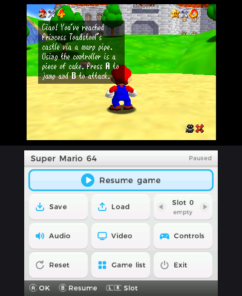
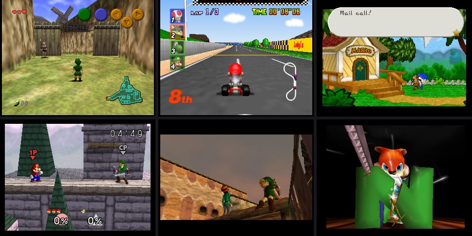
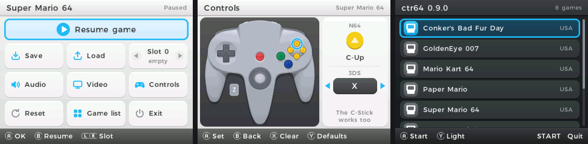
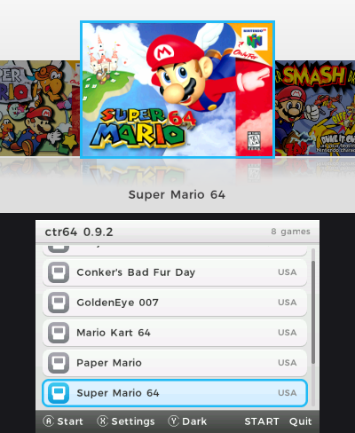

# ctr64: N64 emulation for the Nintendo 3DS

ctr64 runs Nintendo 64 games pretty fast on a 3DS. It is built on the **Mupen64Plus-Next** core, the ARM
dynamic recompiler, RSP HLE, and **GLideN64** with a new PICA200 GPU backend written directly
against libctru's GPU commands.

Basically this project is mupen64plus-next + gliden64 ported to the 3ds with a custom low level graphics backend, dynarec, precompiled lists and multi core processing and a few fun optimizations. It has framebuffer emulation :)

<p align="center"></p>

- **New 3DS / New 2DS XL**: what ive tested on. The CPU emulation, video and audio run on the separate
  cores. Several games run at or close to full speed (Super Mario 64, Ocarina of Time, Paper
  Mario, Super Smash Bros., Mario Kart 64 and others), with optional 2× anti-aliasing. Games
  over about 48 MB (Conker's Bad Fur Day, Resident Evil 2, some ROM hacks) are read from the SD card
  while they run, as on the Old 3DS below.
- **Old 3DS / 2DS**: works, but slower. ctr64 runs in the Old 3DS's 80 MB extended memory mode,
  which leaves room for only the smallest games in memory; most games (Super Mario 64, Mario
  Kart 64, Ocarina of Time, Paper Mario...) are read from the SD card while they run. Their
  first start reads the whole file once (a progress bar shows it), and there can be short
  pauses when the game loads new areas. Use the **.cia** on an Old 3DS (see below).



## Requirements

- A 3DS with custom firmware ([Luma3DS](https://github.com/LumaTeam/Luma3DS)). The recompiler needs
  system calls that CFW provides.
- For sound: `sdmc:/3ds/dspfirm.cdc`, dumped from your own console with
  [DSP1](https://github.com/zoogie/DSP1) (most CFW setups already have it). Without it the games run
  silently. You should have this tho if you installed luma3ds correctly.
- ROMs in `.z64`, `.n64` or `.v64` format.

## Install

**CIA (recommended, required for Old 3DS):** copy `ctr64.cia` to the SD card and install it with
FBI. ctr64 then appears on the HOME Menu.

On an Old 3DS, opening and closing the CIA takes about 10-20 seconds: it asks for an extended memory
mode (80 MB), and the 3DS has to restart its system to switch to it, once when ctr64 opens and again
when it goes back to the HOME Menu. That's normal, it's not frozen.

You can also install (or update) with a QR code: it's on the
[latest release](https://github.com/gl91306/ctr64/releases/latest) page, scan it in FBI
(Remote Install > Scan QR Code).

**3DSX (Homebrew Launcher):** copy `ctr64.3dsx` to `sdmc:/3ds/`. Under the Homebrew Launcher an
Old 3DS gives the app less memory, so use the CIA there.

Copy the `3ds` folder from the release zip to the root of the SD card as well: it holds
`3ds/ctr64/jit/shipped/`, lists of compiled code for some popular games that make their run
minutes smoother. Then put your games in `sdmc:/3ds/ctr64/roms/`. The other folders are created
on first start.

```
sdmc:/3ds/dspfirm.cdc              DSP firmware (sound)
sdmc:/3ds/ctr64/roms/              your games (.z64 / .n64 / .v64)
sdmc:/3ds/ctr64/saves/<ROM>.srm    in-game saves (EEPROM, SRAM, FlashRAM, Controller Pak)
sdmc:/3ds/ctr64/states/<ROM>.stateN  save states, slots 0-9
sdmc:/3ds/ctr64/settings.txt       settings and button mapping (written by the menu)
sdmc:/3ds/ctr64/controls/          per-game button mappings (when a game has its own)
sdmc:/3ds/ctr64/boxart/            downloaded box art
sdmc:/3ds/ctr64/borders/           your own side border pictures (optional)
sdmc:/3ds/ctr64/jit/               per-game lists of compiled code (makes later starts smoother)
sdmc:/3ds/ctr64/core.log           log of the last session; crash.txt if it crashed
```

The `.srm` files have the same format as RetroArch's Mupen64Plus-Next, so you can copy saves
both ways (the name must match the ROM's file name).

## Using it





The **game list** shows the game titles. Tap a game to select it and tap it again (or press **A**) to start it.
Up/down moves one game, **D-pad left/right** jumps to the first game of the previous/next letter
(handy with a lot of games; the Circle Pad just moves one game whichever way you push it); **X** opens the settings, **Y** switches dark mode on or off; **START** quits.

The top screen shows the box art of the selected game. With Wi-Fi on, ctr64 downloads the art
of your games from [libretro-thumbnails](https://github.com/libretro-thumbnails/Nintendo_-_Nintendo_64)
while the game list is open (about 350 KB per game, once) and keeps a 128 KB copy sized for
the screen in `sdmc:/3ds/ctr64/boxart`; games are matched by the cartridge ID in the ROM, so file names do not
matter. Without Wi-Fi, or for games without art (ROM hacks, test ROMs), a card with the title
is shown. To fetch a game's art again, delete its file from that folder (`.none` marks a game
that has no art).

You can use your own pictures, for example for ROM hacks: put a `.png` or `.jpg` with the same name
as the ROM into that folder (`My Hack.z64`: `My Hack.png`) and open ctr64. It converts the picture
while the game list is open (about a second for a normal one), shows it, and removes the original,
so keep a copy. Delete `u_My Hack.bin` to go back to the normal art. If a picture does not show up,
`boxart.log` in that folder says why. Progressive JPGs work, CMYK ones do not.

While a game runs, the bottom screen shows the speed. **SELECT** or a tap on the bottom screen
pauses and opens the menu:

- **Resume**, **Save** / **Load** state, **Slot** (0–9; L/R also change it). Loading a state,
  overwriting a used slot, Reset, Game list and Exit ask for confirmation first.
- **Audio**: volume, sound on or off
- **Video**: frameskip (Auto by default: it skips drawing only while the game runs behind),
  fps limit, anti-aliasing (New 3DS), screen shape (4:3, stretch, widescreen), **side borders**
  (see below),
  **dark mode**, **bottom screen in game** (Menu, Blank, or Off: the backlight goes off; any
  tap still opens the menu), frame buffer emulation and copy mode, and options for threads and
  compiling
- **Controls**: tap a button on the N64 controller picture (or pick it with the D-pad), press A,
  then the 3DS button you want for it; hold two 3DS buttons to put it on both (for example
  shield on L and ZL). X clears, Y resets to the defaults. On the control stick, A selects the
  Circle Pad range, which left/right then change. On the D-pad, A swaps the 3DS D-Pad and Circle
  Pad (the D-Pad then works as the stick, nice for racing games). With a game running, **START**
  saves the controls for just that game (`controls/` folder); START again goes back to the shared
  ones. On a New 3DS the C-Stick works for the C buttons in addition to their mapped buttons.
- **Reset**, **Game list**, **Exit**

**Side borders** fill the bars left and right of a 4:3 picture: **Box art** (the default: the
game's box art, blurred and darkened), **Console** (grey plastic with a D-pad and buttons) or
**Off**. Your own picture wins over both: put a `.png` or `.jpg` named like the ROM into
`sdmc:/3ds/ctr64/borders` (`My Game.z64`: `My Game.png`), or `default.png` for every game without
its own. A 400x240 picture is used as it is (only its outer 40 pixels on each side show); other
sizes are scaled to cover the screen.

**Voice games**: Hey You, Pikachu! and Densha de GO! 64 use the N64's Voice Recognition Unit,
and ctr64 uses the 3DS microphone for it. Hold the N64 **Z** button (L by default) while you
speak, and let go when you are done; the game then gets the word you said. The words are
recognized on the 3DS itself, with a small speech model built into ctr64 (no internet needed),
after you let go, so the game keeps running at full speed while you talk. Speak clearly and
close to the microphone; Densha de GO! 64 expects its Japanese words.

Default controls:

| N64 | New 3DS | Old 3DS |
|---|---|---|
| Control stick | Circle Pad | Circle Pad |
| C buttons | C-Stick, X (C-Up), Y (C-Left) | D-Pad |
| D-Pad | D-Pad | (used by the C buttons) |
| A / B | A / B | A / B |
| Z | L | L |
| L / R | ZL / R | X / R |
| Start | START | START |

Anti-aliasing, screen shape and frame buffer emulation take effect when a game starts. A changed
value turns orange, and a banner offers **Restart** (X), which starts the same game again with
the new settings (CIA; with the .3dsx, start ctr64 again).

## Building

On Windows:

1. Install [devkitPro](https://devkitpro.org/wiki/Getting_Started) with the **3DS development**
   group (devkitARM, libctru, picasso, 3dsxtool, smdhtool), in `C:\devkitPro`, plus the
   `3ds-curl`, `3ds-mbedtls`, `3ds-libpng` and `3ds-zlib` packages (box art downloads):
   `pacman -S 3ds-curl 3ds-mbedtls 3ds-libpng 3ds-zlib` in devkitPro's MSYS2 shell.
2. Install git.
3. For the `.cia`, put `makerom` (from [Project_CTR](https://github.com/3DSGuy/Project_CTR/releases))
   on your `PATH` or in `C:\devkitPro\tools\bin`. Without it you get only the `.3dsx`.
4. Run:

   ```
   powershell -ExecutionPolicy Bypass -File scripts\build-3ds.ps1
   ```

The script clones Mupen64Plus-Next at the commit in `ctr64/patches/BASE_COMMIT` into
`third_party/`, applies `ctr64/patches/mupen64plus-libretro-nx.patch` (all core and GLideN64
changes, listed in `ctr64/patches/README.md`), and builds with CMake (preset `3ds-release`) through
devkitPro's msys2. On Linux or macOS, do the same steps by hand: clone and patch the core, then
run `cmake --preset 3ds-release && cmake --build --preset 3ds-release` with devkitPro's CMake.
The output is `dist/3ds/ctr64.3dsx`, `ctr64.cia` and `ctr64.elf`. Crash
addresses in `crash.txt` resolve with `arm-none-eabi-addr2line -e dist/3ds/ctr64.elf <address>`.
`scripts\package-release.ps1` then puts the release zip together (`dist/3ds/ctr64-release.zip`).
The version number is `CTR64_VERSION` in `ctr64/CMakeLists.txt`.

Source layout:

```
ctr64/src/            the 3DS app: main loop, core host, menu and UI (ui/), audio, threads
ctr64/src/gfx/        GLideN64 -> PICA200 backend (render targets, textures, combiners to TEV)
ctr64/src/pica/       thin layer over libctru GPU commands and the GX queue
ctr64/src/platform/   JIT memory and cache maintenance for the recompiler
ctr64/shaders/        the vertex shader (picasso)
ctr64/patches/        the patch to Mupen64Plus-Next and its documentation
ctr64/cia/            CIA settings (memory mode, CPU speed, system calls)
ctr64/jit-shipped/    compiled-code lists for some games (the release zip's 3ds/ctr64/jit/shipped/)
tools/ui/             generators for the menu icons and the controller picture (the photo it was
                      traced from is not included)
```

## Troubleshooting

- **No sound**: `sdmc:/3ds/dspfirm.cdc` is missing (see Requirements).
- **"Could not start"**: the file is not an N64 ROM or could not be read.
- **Old 3DS, a big game pauses briefly in new areas**: it is reading that part of the game from
  the SD card. A faster SD card helps.
- **A game is slow at first**: the recompiler is translating new code. ctr64 remembers it in
  `sdmc:/3ds/ctr64/jit/` and compiles it ahead of time on later runs.
- **Graphics problems in a game**: try Video → Frame buffer emulation and Frame buffer copy.
- **A crash**: `sdmc:/3ds/ctr64/crash.txt` and `core.log` help to report it.
- Additionally, if you have a crash or visual bug you want to report, set the profiler to "Detailed" and set the resulting game profile from /profile/game-name-timestamp along with your crash core and settings files, it would be really helpful :)

Debug info in the Video menu shows the internal counters.

## Credits

Thank you to:

- **[Mupen64Plus-Next](https://github.com/libretro/mupen64plus-libretro-nx)** (the libretro team
  and the [Mupen64Plus](https://github.com/mupen64plus) authors): the N64 emulation itself, used
  with a patch. That covers the R4300 CPU (interpreter and the
  **new_dynarec** ARM recompiler by **Ari64**), memory map, PIF and controllers, save types
  (EEPROM, SRAM, FlashRAM, Controller Pak), save states, the **RSP HLE** (audio and graphics task
  handling), and the libretro glue that ctr64 hosts.
- **[GLideN64](https://github.com/gonetz/GLideN64)** (Sergey Lipskiy / gonetz and contributors):
  the graphics emulation. ctr64 keeps its display list processing, combiner decoding, texture
  cache, frame buffer emulation and per-game settings, and replaces the OpenGL part with a new
  PICA200 backend (`ctr64/src/gfx/`).
- **[DaedalusX64-3DS](https://github.com/masterfeizz/DaedalusX64-3DS)** by **MasterFeizz**: the
  N64 emulator that showed me the 3DS could actually emulate the N64, and what i measured against when developing.
  Ideas taken from it: interpreting code until it is hot before compiling it (from its trace
  dynarec), running audio HLE on a second core of the New 3DS, and counting game frames by
  new VI origins.
- **[PCSX-ReARMed](https://github.com/notaz/pcsx_rearmed)** by **notaz** and **Lightrec**: their
  work on compiling on another thread was the reference for ctr64's compile thread.
- **[devkitPro](https://devkitpro.org/)** (devkitARM, libctru, picasso, 3dsxtool) and
  **[3dbrew](https://www.3dbrew.org/)**: the toolchain and the hardware documentation the
  PICA200 backend is written against.
- **[Luma3DS](https://github.com/LumaTeam/Luma3DS)**, which provides the system calls that
  the recompiler needs.
- **[Azahar](https://github.com/azahar-emu/azahar)**: the 3DS emulator that most of the
  development and testing ran on.
- **[Project_CTR](https://github.com/3DSGuy/Project_CTR)** (makerom) for building the CIA.
- **[libretro-thumbnails](https://github.com/libretro-thumbnails/libretro-thumbnails)** and
  **[libretro-database](https://github.com/libretro/libretro-database)**: the box art in the game
  list and the cartridge IDs that find it (`tools/ui/boxart_names.py`). curl, mbedTLS, libpng and
  zlib (devkitPro portlibs) download and decode it.

## Licenses

ctr64 links Mupen64Plus-Next (GPL-2.0 or later; GLideN64 is GPL-2.0 or later), so the 3DS app
as a whole is distributed under the **GPL-2.0-or-later**: share the source (this repository and the
patch) with any binaries. libctru is zlib-licensed; libretro.h is MIT.

This repository does not host any copyrighted material
